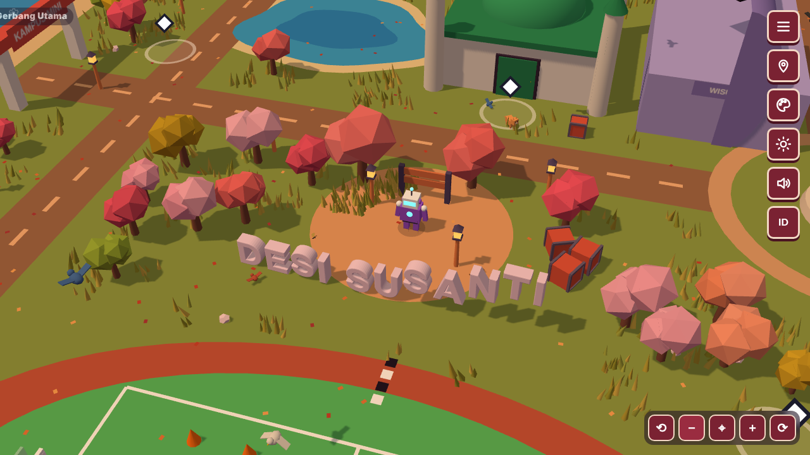
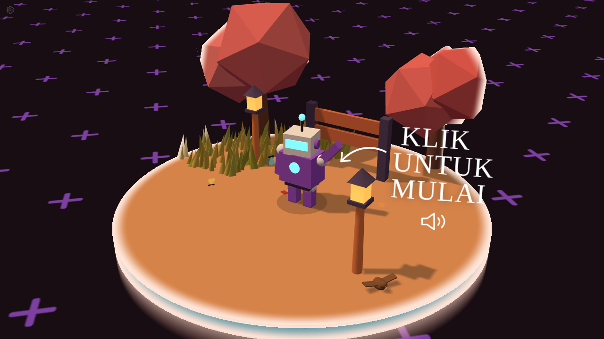
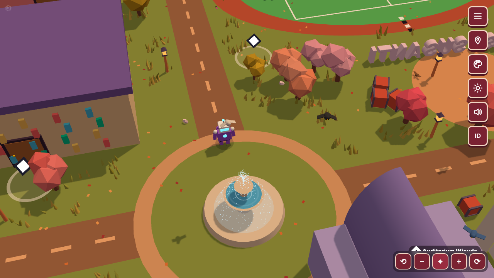
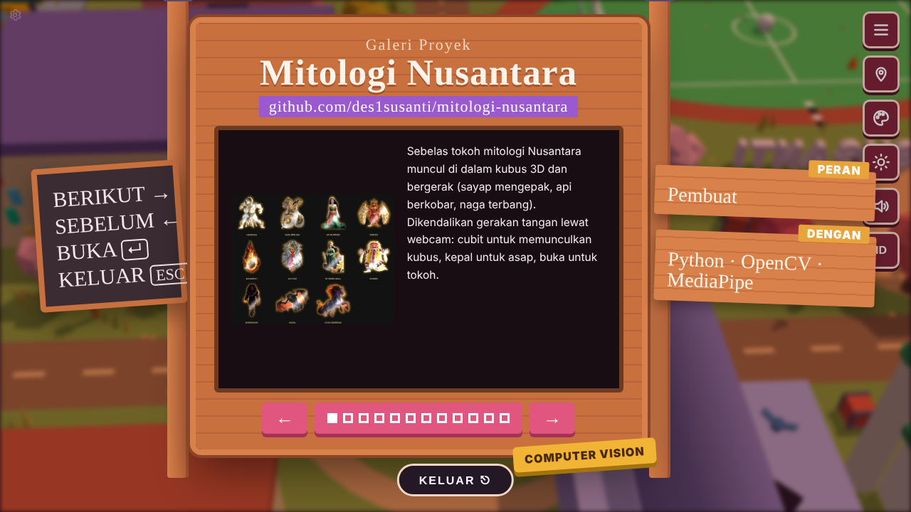
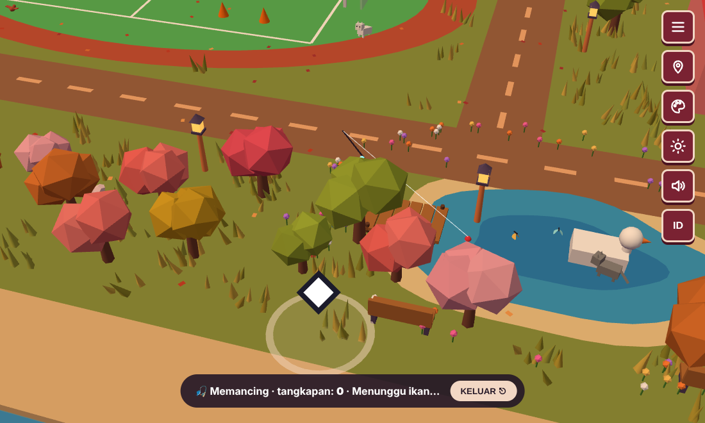
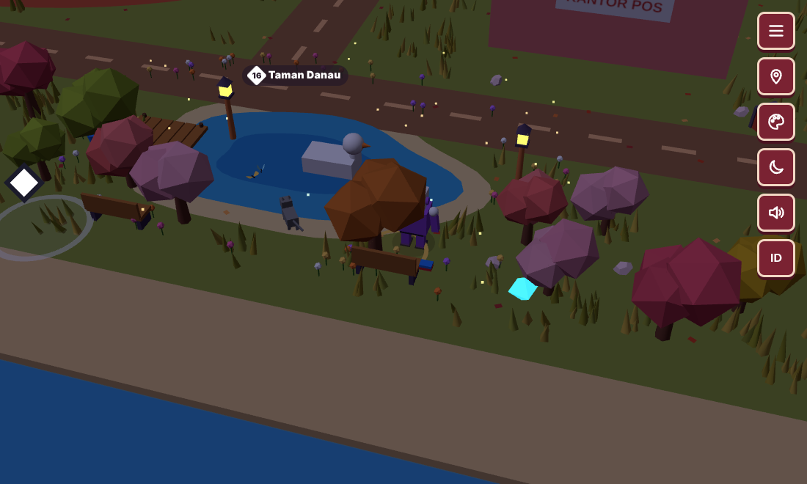
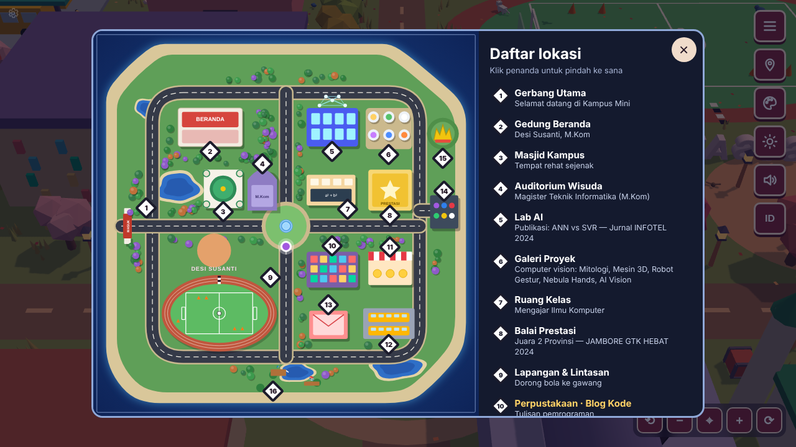
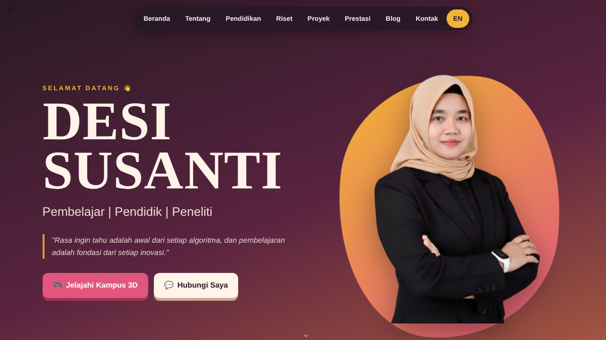
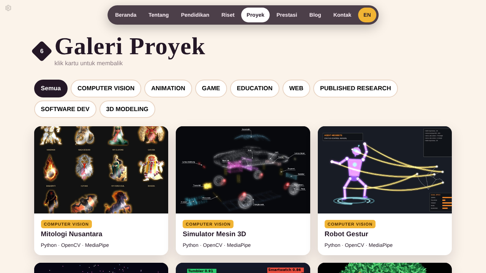
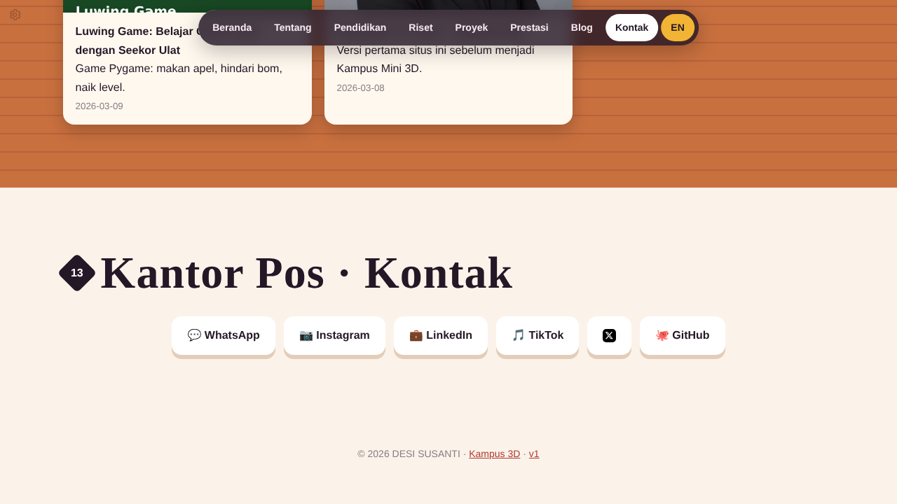

# Kampus Mini — Portofolio 3D Desi Susanti

**EN:** An interactive 3D portfolio: walk a little robot around a mini campus and visit buildings to read
about my research, projects, achievements and blog (code, food, travel).

**ID:** Portofolio 3D interaktif: jalankan robot kecil berkeliling kampus mini, datangi gedung-gedung untuk
membaca riset, proyek, prestasi, dan blog (kode, kuliner, jalan-jalan).

### 🎮 [Jelajahi Kampus Mini 3D →](https://des1susanti.github.io/portofolio-v2/)  ·  📄 [Mode biasa →](https://des1susanti.github.io/portofolio-v2/classic.html)

Versi pertama: [des1susanti.pythonanywhere.com](https://des1susanti.pythonanywhere.com)

<table>
  <tr>
    <td> Layar awal: klik untuk mulai</td>
    <td> Air mancur di bundaran</td>
  </tr>
</table>

## Cara bermain

| Kontrol | Fungsi |
|---|---|
| `W A S D` / tombol panah | Jalankan robot |
| `Shift` | Berlari |
| Seret layar | Geser pandangan |
| Seret klik-kanan / `Q` `E` | Putar kamera |
| Gulir mouse / tombol `+` `−` | Perbesar / perkecil |
| Tombol ⌖ | Kamera kembali ke belakang robot |
| Klik gedung | Muncul catatan singkat isi gedung |
| Masuk pintu ◆ | Pintu terbuka, robot masuk, papan isi muncul |
| `←` `→` / `Enter` / `Esc` | Di dalam gedung: geser isi / buka tautan / keluar |
| `M` / `N` | Peta / siang-malam |
| Tuas pojok kiri bawah | Kontrol di HP |

Tombol di pojok kanan atas: **menu**, **peta**, **warna robot**, **siang/malam**, **suara**, **ID/EN**.

**Hal-hal kecil:** musik latar ceria · rumput dan daun bergoyang · kucing, burung, kupu-kupu, kunang-kunang (malam) ·
air mancur di bundaran · memancing di dermaga Taman Danau · membaca buku di bangku taman (tersambung ke Google Books) ·
mini game bola dan lintasan · permata tersembunyi.

<table>
  <tr>
    <td> Papan isi gedung: Galeri Proyek</td>
    <td> Memancing di Taman Danau</td>
  </tr>
  <tr>
    <td> Mode malam</td>
    <td> Peta: klik lokasi untuk pindah</td>
  </tr>
</table>

## 16 lokasi

1 Gerbang Utama · 2 Gedung Beranda · 3 Masjid Kampus · 4 Auditorium Wisuda · 5 Lab AI · 6 Galeri Proyek ·
7 Ruang Kelas · 8 Balai Prestasi · 9 Lapangan & Lintasan · 10 Perpustakaan (Blog Kode) · 11 Kantin (Blog Kuliner) ·
12 Terminal Bus (Blog Jalan-jalan) · 13 Kantor Pos (Kontak) · 14 Bengkel Cat Robot · 15 Menara Siger · 16 Taman Danau

## Mode biasa

Versi tanpa 3D, cocok untuk HP atau komputer yang lambat: animasi ringan, galeri foto, kartu proyek yang bisa dibalik,
filter proyek, dan blog. Buka lewat menu di Kampus 3D atau langsung di
[des1susanti.github.io/portofolio-v2/classic.html](https://des1susanti.github.io/portofolio-v2/classic.html).

<table>
  <tr>
    <td> Beranda</td>
    <td> Galeri proyek</td>
  </tr>
  <tr>
    <td colspan="2"> Kontak</td>
  </tr>
</table>

## Dibuat dengan

Three.js · JavaScript · HTML · CSS · GitHub Pages

---

Terinspirasi dari konsep portofolio interaktif [Bruno Simon](https://bruno-simon.com/) ([github.com/brunosimon](https://github.com/brunosimon)). Kode dikembangkan sendiri dengan bantuan AI, tanpa menyalin kode dari proyek tersebut.
